# 🚍 BUCARATRANSIT — Plataforma de Movilidad para Bucaramanga

> Antes *Bus UNAB — VibraBus*. Hoy es **BUCARATRANSIT**, un **SaaS de movilidad urbana multi-tenant** (ver [NAMING_DECISION.md](Bucaramanga_Mobility_Rebranding/NAMING_DECISION.md)).

Plataforma compuesta por un **backend Laravel (API REST + paneles Filament `/admin` y `/empresa`)** y una **app móvil Kotlin Multiplatform (Android/iOS)**: rutas y buses en vivo, wallet prepago, QR dinámico de pago y cobro a bordo (modo conductor). La app es *white-label*: logo, mascota, colores y textos de cada organización se descargan de la API.

- **Producción:** https://bucaratransit.duckdns.org (paneles en `/admin` y `/empresa`).
- **Guion de la demo:** [docs/GUION_DEMO.md](docs/GUION_DEMO.md) — ciclos a mostrar, checklist previo y qué no enseñar.
- **Estado y hallazgos:** [docs/PLAN_REVISION.md](docs/PLAN_REVISION.md).

---

## 📸 Cómo se ve

### App móvil (pasajero y conductor)

| Login con marca | Inicio | Buscar rutas | Ruta elegida |
|---|---|---|---|
| 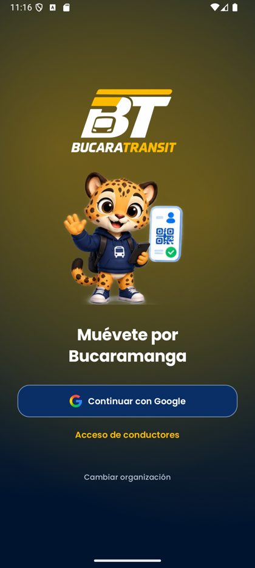 | 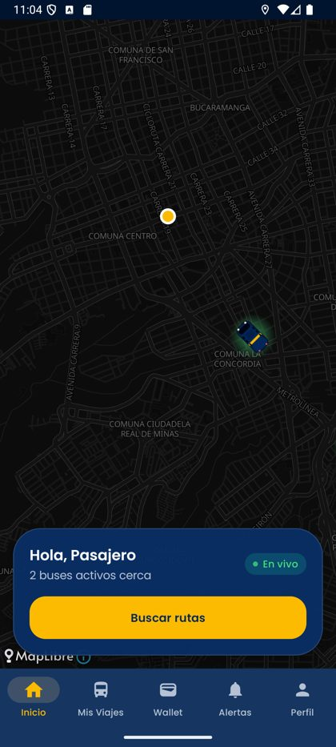 | 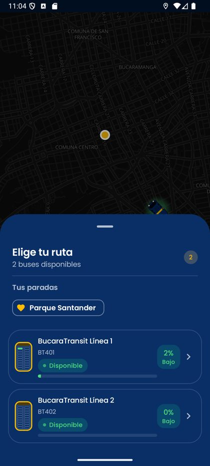 | 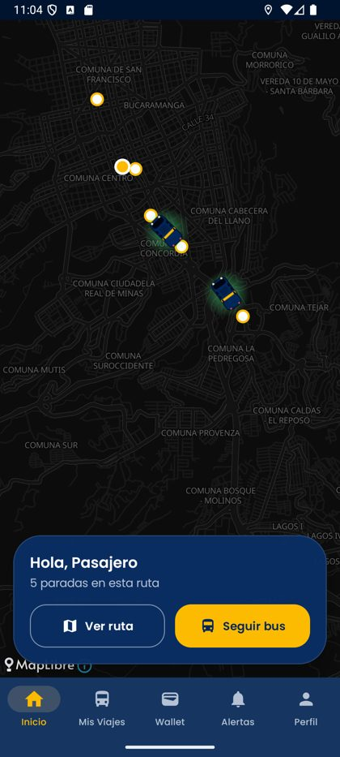 |

| Parada | Siguiendo un bus | Wallet | Modo conductor |
|---|---|---|---|
| 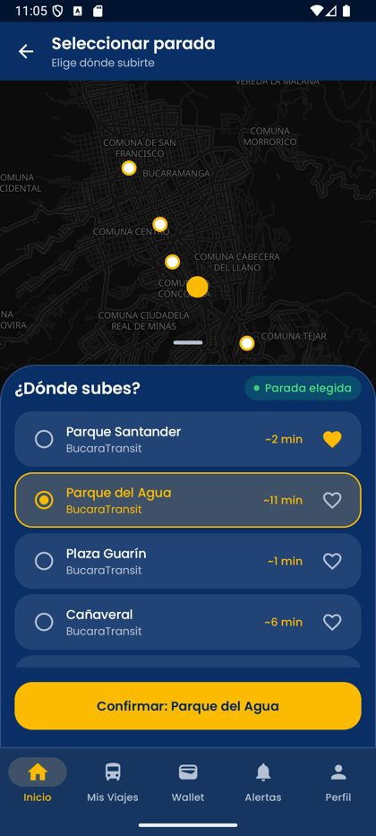 | 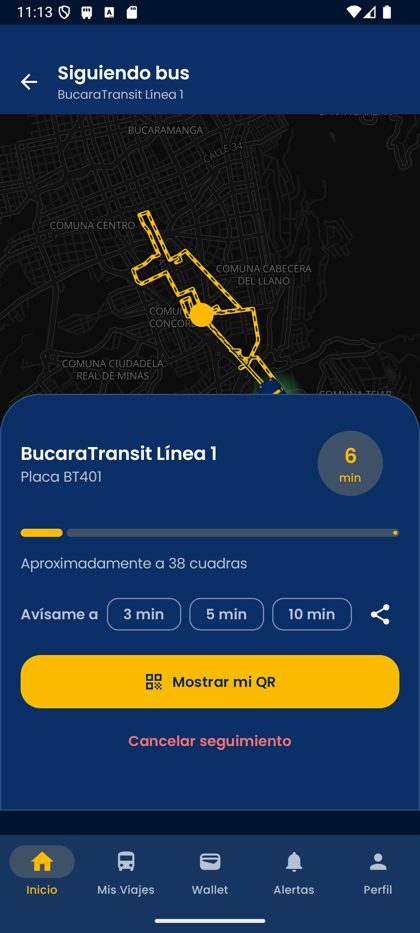 | 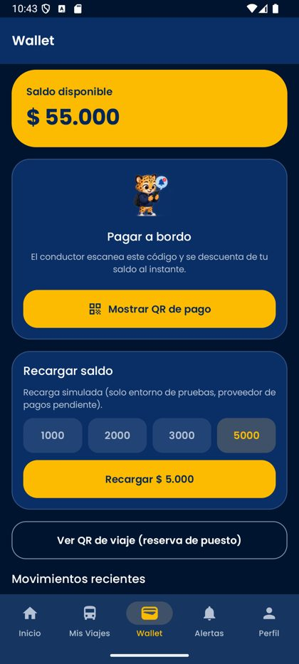 | 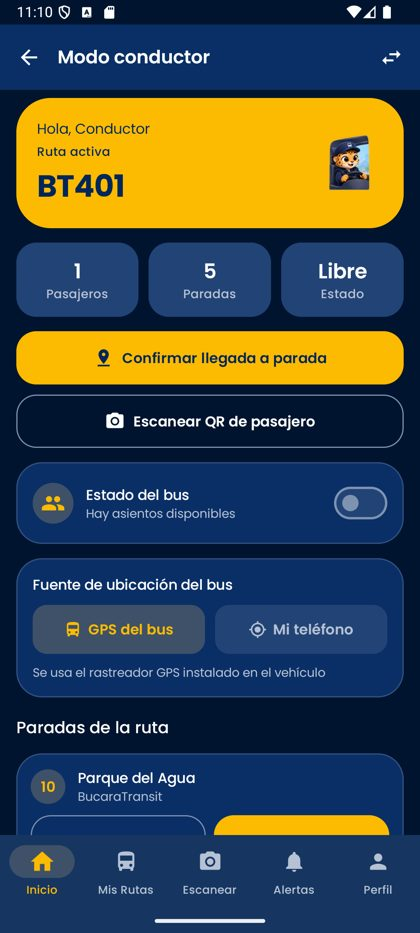 |

Los buses se dibujan sobre el mapa (MapLibre + OpenFreeMap, sin API key) con un *glow* translúcido del color de su estado, sin disco blanco.

### Panel Super Admin (`/admin`)

| Escritorio | Mapa en vivo |
|---|---|
| 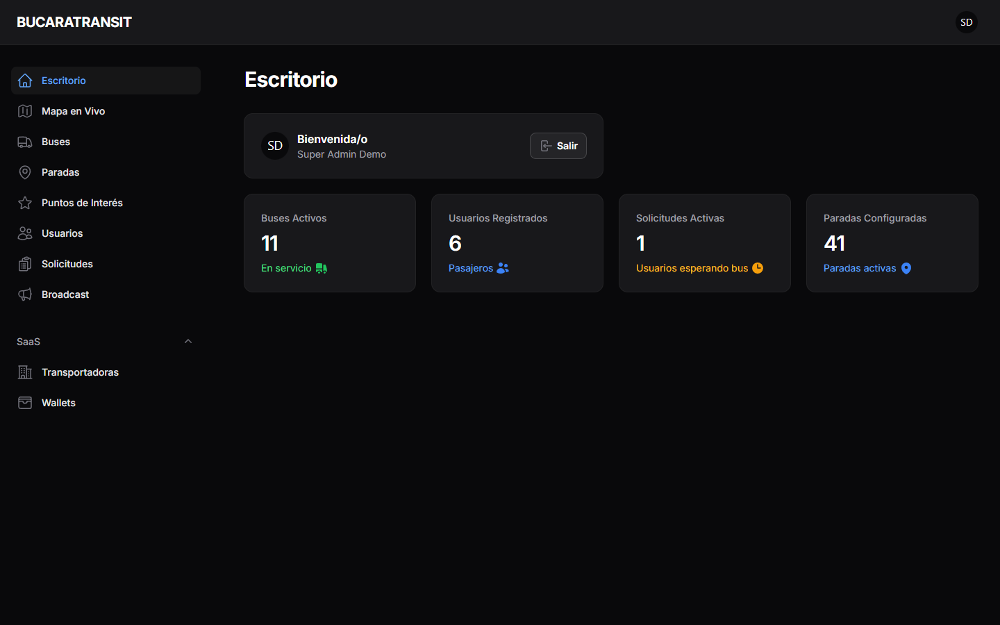 | 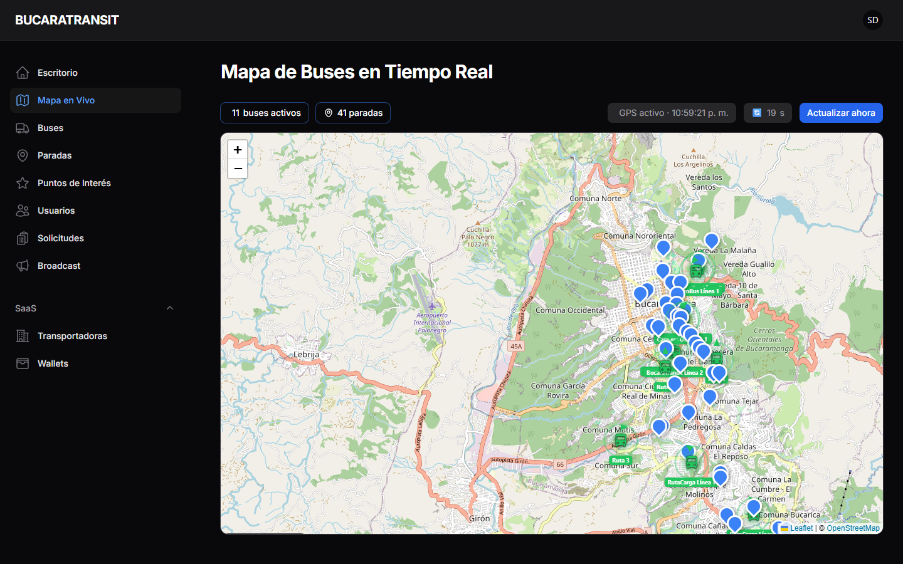 |
| **Editor de ruta** (arrastrar paradas + vista previa por calles) | **Crear parada** (buscar dirección y mover el pin) |
| 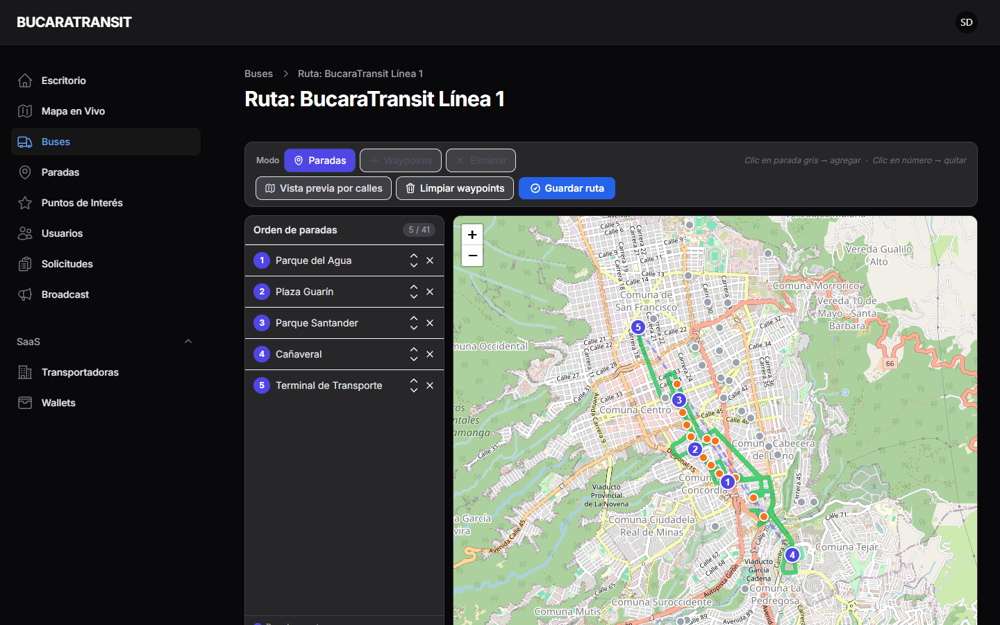 | 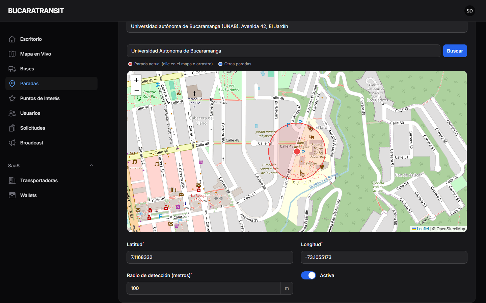 |
| **Wallets** | **Transportadoras (tenants)** |
| 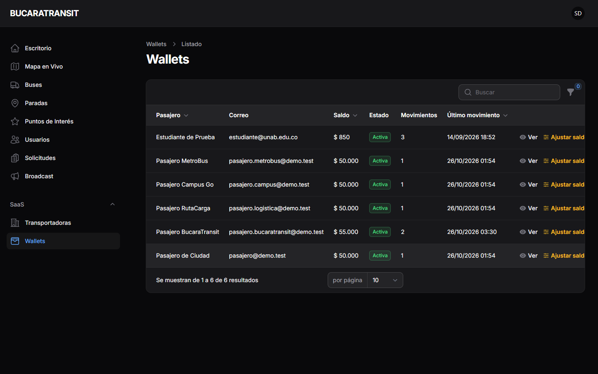 | 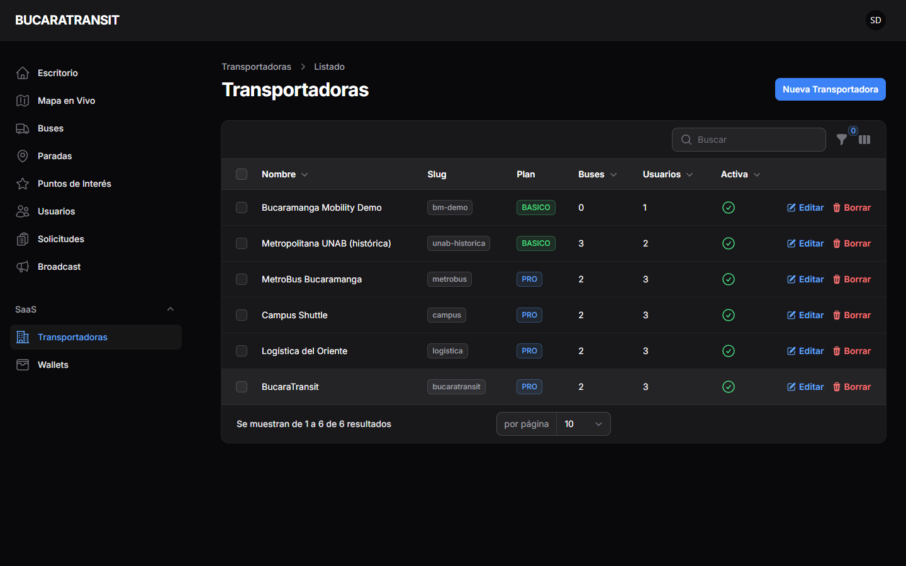 |

### Panel de la transportadora (`/empresa`)

| Escritorio con métricas propias | Mapa en vivo de su flota |
|---|---|
| 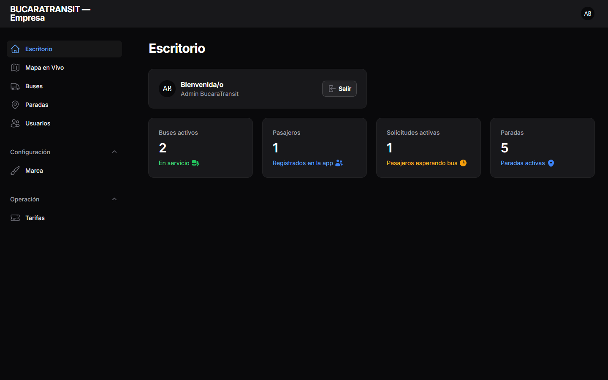 | 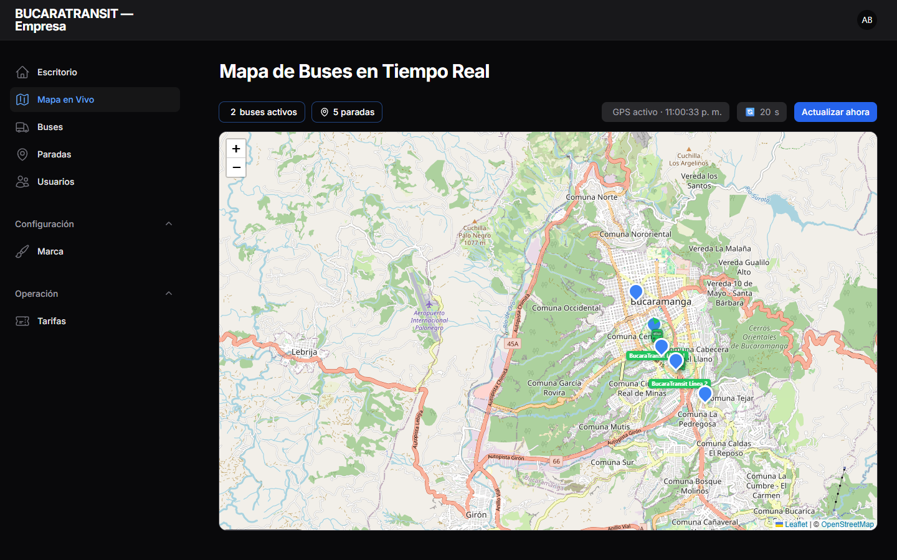 |

---

## 📁 Estructura del repositorio

```
bus_unab/
├── bus_unab/        ← Backend Laravel (API + Panel Filament)
└── frontend/        ← App móvil Kotlin Multiplatform (Android / iOS)
```

---

## ⚡ Prueba rápida (demo local)

```powershell
.\scripts\dev-up.ps1 -Simulate     # Linux/macOS: scripts/dev-up.sh --simulate
```
Instala dependencias, prepara datos demo (orgs `bucaratransit`, `metrobus`, `campus`, `logistica`; clave `Demo12345!`), levanta la API en `http://<IP_LAN>:8000` e imprime el comando para instalar la app:

```
./gradlew :composeApp:installDebug -PapiBaseUrl=http://<IP>:8000/api/v1 -PdefaultOrgSlug=bucaratransit
```
Flags: `-Fresh` (recrea BD), `-Stop`, `-Port`. Detalle en [docs/DEMO.md](docs/DEMO.md). Para que los buses se muevan, agrega `-Simulate` (o en la VM: `php artisan demo:simulate-buses --speed=30`). En emulador Android usa `http://10.0.2.2:8000/api/v1` como `apiBaseUrl`. Solo para desarrollo.

---

## ⚙️ BACKEND — Laravel

### Requisitos previos
| Herramienta | Versión mínima |
|---|---|
| PHP | ≥ 8.2 |
| Composer | ≥ 2.x |
| MySQL | ≥ 8.0 (MariaDB no soportado; SQLite solo para desarrollo/tests) |
| Node.js | ≥ 18 (solo para assets Filament) |

### 1. Instalar dependencias

```bash
cd bus_unab
composer install
```

### 2. Configurar variables de entorno

```bash
cp .env.example .env
php artisan key:generate
```

Edita `.env` con tus datos:

```dotenv
APP_NAME="BUCARATRANSIT"
APP_URL=http://localhost:8000

# ── Base de datos (MySQL) ────────────────────────────────────────────────
DB_CONNECTION=mysql
DB_HOST=127.0.0.1
DB_PORT=3306
DB_DATABASE=bus_unab          # ← nombre de tu base de datos
DB_USERNAME=root               # ← tu usuario MySQL
DB_PASSWORD=tu_password        # ← tu contraseña MySQL

# ── Alternativa rápida (SQLite) ──────────────────────────────────────────
# DB_CONNECTION=sqlite
# (se crea automáticamente en database/database.sqlite)
```

> **SQLite** (ya configurado por defecto) es ideal para pruebas locales.  
> Para producción usa **MySQL**.

### 3. Migrar y poblar la base de datos

```bash
# Crear tablas
php artisan migrate

# Poblar con datos de prueba (usuarios, rutas, paradas)
php artisan db:seed
```

### 4. Iniciar el servidor

```bash
# Local (solo tu máquina)
php artisan serve

# Accesible desde la red local (para la app móvil en emulador/físico)
php artisan serve --host=0.0.0.0 --port=8000
```

La API estará disponible en: `http://TU_IP_LOCAL:8000/api/v1`

---

## 📱 FRONTEND — Kotlin Multiplatform (Android / iOS)

### Requisitos previos
| Herramienta | Versión mínima |
|---|---|
| Android Studio | Hedgehog o superior |
| JDK | 17 |
| Gradle | 8.10 (incluido en el wrapper) |
| Xcode | 15+ (solo para iOS) |
| Android SDK | API 26+ |

### 1. Abrir el proyecto

Abre la carpeta `frontend/` directamente en **Android Studio** (no la raíz del repositorio).

```
File → Open → .../bus_unab/frontend
```

### 2. Configurar la URL de la API

Edita `frontend/composeApp/build.gradle.kts` y ajusta la IP de tu servidor:

```kotlin
defaultConfig {
    // IP de tu máquina en la red local (donde corre Laravel)
    buildConfigField("String", "BASE_URL_ANDROID", "\"http://192.168.X.X:8000/api/v1\"")
    buildConfigField("String", "BASE_URL_IOS",     "\"http://localhost:8000/api/v1\"")
    ...
}
```

> 🔎 Para saber tu IP local ejecuta `ipconfig` (Windows) o `ifconfig` (Mac/Linux).  
> En emulador Android puedes usar `10.0.2.2` en lugar de tu IP real.

### 3. Configurar Firebase y Google Sign-In

#### 3.1 Crear proyecto Firebase

1. Ve a [Firebase Console](https://console.firebase.google.com/)
2. Crea un proyecto (o usa uno existente)
3. Agrega una app **Android** con el package name: `com.vibra.bus`

#### 3.2 Descargar `google-services.json`

1. En la consola Firebase → **Configuración del proyecto** → **Tus apps**
2. Descarga el archivo `google-services.json`
3. Colócalo en la siguiente ruta (exacta):

```
frontend/
└── composeApp/
    └── google-services.json   ← aquí va el archivo
```

> ⚠️ **Este archivo NO se sube al repositorio** (está en `.gitignore`).  
> Cada desarrollador debe obtener su propio `google-services.json`.

#### 3.3 Configurar Google Server Client ID

En `frontend/composeApp/build.gradle.kts`, reemplaza el valor del Client ID con el tuyo:

```kotlin
buildConfigField(
    "String",
    "GOOGLE_SERVER_CLIENT_ID",
    "\"TU_CLIENT_ID_WEB.apps.googleusercontent.com\""
)
```

El **Web Client ID** lo encuentras en:  
Firebase Console → Authentication → Sign-in method → Google → **ID de cliente web**

### 4. Sincronizar y compilar

En Android Studio:
1. `File` → **Sync Project with Gradle Files** (espera a que termine)
2. `Build` → **Make Project** (`Ctrl+F9`)
3. Selecciona un emulador o dispositivo físico
4. Presiona **▶ Run**

---

## 🔑 Credenciales demo (solo local)

`DemoSeeder` (lo corre `scripts/dev-up.ps1`) crea 4 organizaciones y estas cuentas, todas con la clave **`Demo12345!`**:

| Rol | Email | Dónde entra |
|---|---|---|
| Super Admin | `superadmin@demo.test` | `/admin` |
| Admin de transportadora | `admin.bucaratransit@demo.test` | `/empresa` |
| Conductor | `driver.bucaratransit@demo.test` | App → "Acceso de conductores" |
| Pasajero | `pasajero.bucaratransit@demo.test` | App |

> ⚠️ Estas claves son públicas (están en el repo). En producción se rotan y quedan solo en la VM; nunca uses las de demo fuera de tu máquina.

---

## 🌐 Paneles web

Los mapas de los paneles usan **Leaflet + OpenStreetMap** (búsqueda de direcciones con Nominatim y vista previa de recorrido con OSRM), así que funcionan sin `GOOGLE_MAPS_API_KEY`.

- **Super Admin — `/admin`**: transportadoras (tenants), usuarios y roles, buses, rutas y paradas, editor visual de rutas, mapa en vivo de toda la flota, wallets y movimientos, solicitudes de bus, puntos de interés, tarifas, auditoría y difusión de notificaciones push.
- **Transportadora — `/empresa`**: cada empresa ve solo lo suyo (aislamiento por tenant): métricas de su flota, mapa en vivo, buses y editor de rutas, paradas, conductores, tarifas por ruta, recaudo y su marca (logo, mascota, colores) que la app descarga.

Avisos que muestran los paneles cuando falta configuración:
- **Difusión push** avisa "Push no configurado" si falta `FIREBASE_CREDENTIALS_B64`, y "Sin destinatarios" si no hay dispositivos registrados.
- El **widget de Google Calendar** se oculta si `GOOGLE_CALENDAR_ID` está vacío.

Pruebas de humo: `tests/Feature/Admin/PanelPagesSmokeTest.php` abre cada página de ambos paneles y exige 200; `BusMapDataTest` verifica que un admin de empresa solo vea su flota.

---

## 🧭 Documentación de pivote

El rebranding y la migración a SaaS multi-tenant están documentados en [`Bucaramanga_Mobility_Rebranding/`](Bucaramanga_Mobility_Rebranding/README.md):

| Doc | Contenido |
|---|---|
| [BRAND.md](Bucaramanga_Mobility_Rebranding/BRAND.md) | Matriz de marca: working name, posición, pilares, tono/voz, alcance, paleta |
| [CONCEPTO.md](Bucaramanga_Mobility_Rebranding/CONCEPTO.md) | Concepto y pilares del producto (multi-tenant, wallet, QR/mPOS) |
| [DISEÑO_DB.md](Bucaramanga_Mobility_Rebranding/DISEÑO_DB.md) | Diseño de base de datos multi-tenant (tablas, índices, migraciones) |
| [GLOSSARY.md](Bucaramanga_Mobility_Rebranding/GLOSSARY.md) | Glosario canónico ES ↔ técnico (tenant, wallet, mPOS, ledger…) |
| [NAMING_DECISION.md](Bucaramanga_Mobility_Rebranding/NAMING_DECISION.md) | Decisión de nombre final (PENDIENTE del usuario) y checklist de rename |
| [MATRIZ_BRANDING.md](Bucaramanga_Mobility_Rebranding/MATRIZ_BRANDING.md) | Matriz archivo → cambio (qué se renombra, qué está congelado) |
| [AUDIT.md](Bucaramanga_Mobility_Rebranding/AUDIT.md) · [ARCHITECTURE.md](Bucaramanga_Mobility_Rebranding/ARCHITECTURE.md) | Auditoría del código actual y arquitectura objetivo |
| [ROADMAP_TECNICO.md](Bucaramanga_Mobility_Rebranding/ROADMAP_TECNICO.md) | Fases F0–F4 con criterios de salida |

> ⚠️ El **package técnico de la app sigue siendo `com.vibra.bus`** (identificador congelado de Play Store; no es branding visible). Ver MATRIZ_BRANDING.md §2.

---

## 🛠️ Problemas comunes

### La app no conecta con el servidor
- Verifica que Laravel esté corriendo con `--host=0.0.0.0`
- Confirma que la IP en `build.gradle.kts` coincide con la de tu máquina
- Revisa que el firewall no bloquee el puerto 8000

### Error `google-services.json not found`
- Descarga el archivo desde Firebase Console y colócalo en `composeApp/`
- Haz Sync en Android Studio

### Error `Unresolved reference 'generated'`
- En Android Studio: `File` → **Sync Project with Gradle Files**
- Luego: `Build` → **Make Project**

### Error de migración
```bash
php artisan migrate:fresh --seed   # reinicia y repuebla la BD
```

---

## 📞 Contacto

Proyecto desarrollado originalmente por el equipo **VIBRA+** de la Universidad Autónoma de Bucaramanga (UNAB) — *origen académico del proyecto; hoy opera como plataforma independiente bajo la marca "BUCARATRANSIT"*
